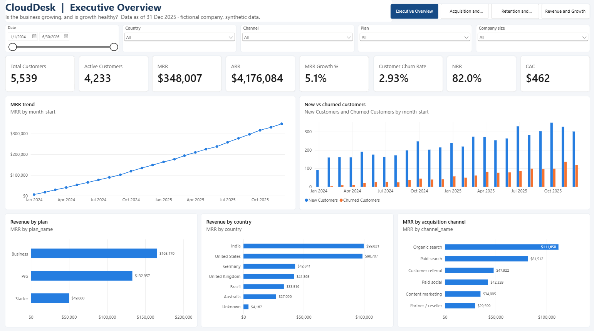
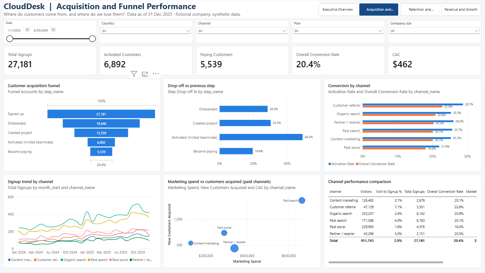
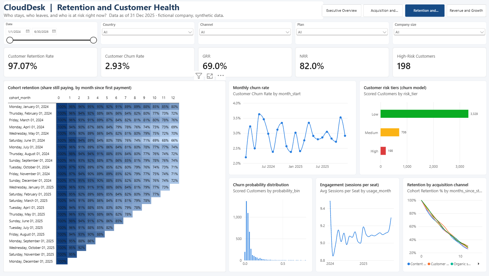
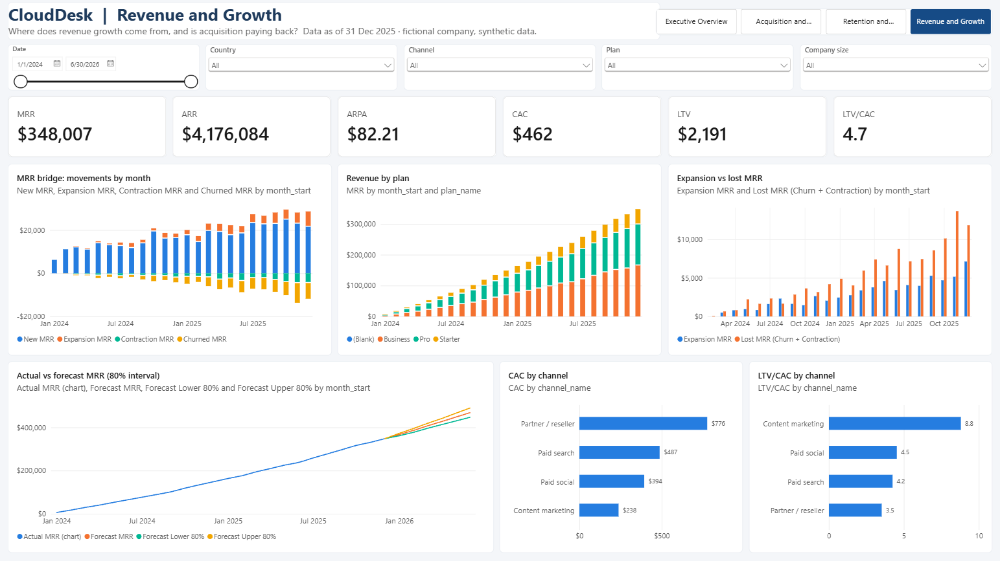
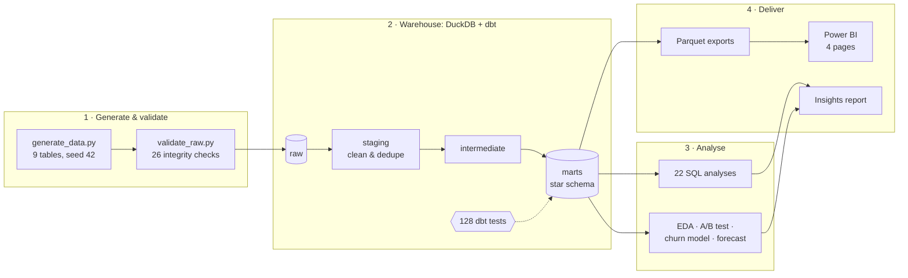
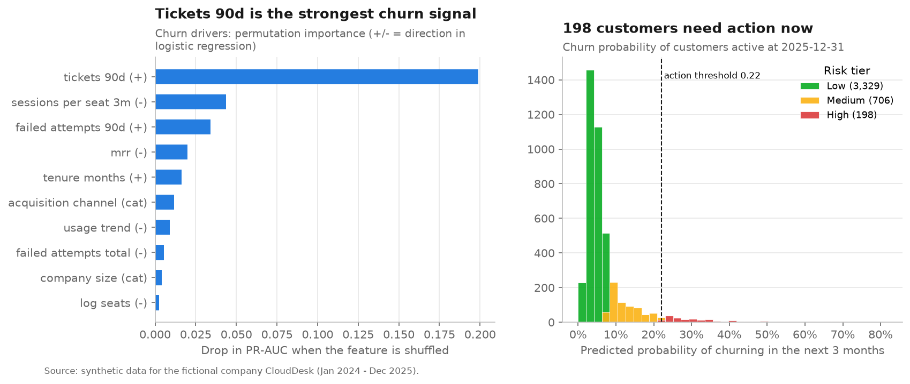
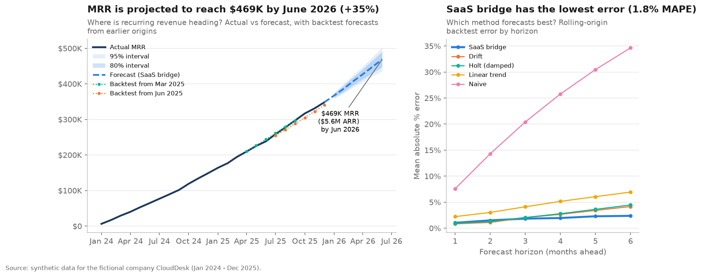

<div align="center">

# CloudDesk SaaS Growth Analytics

**End-to-end analytics for a B2B SaaS business: from raw product and billing data to a tested warehouse,
experimentation, churn prediction, revenue forecasting and an executive Power BI dashboard.**

[](https://github.com/sudh1404/saas-growth-analytics/actions/workflows/ci.yml)




</div>

> **Note:** CloudDesk is a fictional company and all data is synthetic (generated with a fixed seed). The numbers
> demonstrate analytical method, not real-world benchmarks.

---

## Table of contents
- [Business problem](#business-problem)
- [Key findings](#key-findings)
- [Dashboard](#dashboard)
- [Architecture](#architecture)
- [Tech stack](#tech-stack)
- [Quick start](#quick-start)
- [Methodology](#methodology)
- [Data quality and testing](#data-quality-and-testing)
- [Project structure](#project-structure)
- [Documentation](#documentation)
- [Limitations and next steps](#limitations-and-next-steps)

---

## Business problem
CloudDesk sells a collaborative workspace on monthly plans (Starter **$29**, Pro **$79**, Business **$199**) after a
14-day free trial. Revenue more than doubled in 2025, but leadership needs answers before planning the next year:

1. Which acquisition channels bring customers who **convert, stay and pay back** their acquisition cost?
2. Where do trial users **drop out of the funnel**?
3. Is growth driven by **new or existing customers**, and how much revenue does churn cost?
4. Should we **ship the new pricing page** that was A/B tested?
5. **Which customers are about to churn**, and why?
6. Where will **MRR be in six months**?

## Key findings
| | Finding | Evidence |
|---|---|---|
| 📈 | **Growth is strong but slowing.** MRR reached **$348K** (ARR **$4.18M**), +134% in 2025. | Month-over-month growth fell from 10.2% to 5.1% |
| 🔁 | **Retention is the main constraint.** Churn and contraction erased **39% of new MRR** in 2025. | NRR **82%**, GRR **69%** (trailing 12 months) |
| 🚪 | **The biggest funnel leak is activation.** 49% of trial users who create a project never invite a teammate. | Activated trials convert at **45%** vs **12%** |
| 💳 | **28% of churn is involuntary** (failed payments): the cheapest churn to fix. | 30% of churners leave within their first 2 months |
| 💰 | **Every paid channel is profitable, but not equally.** Content returns the most per dollar. | Paid CAC **$462**; LTV/CAC from **8.8x** (Content) to **3.5x** (Partner) |
| 🧪 | **Ship the pricing-page change.** Conversion lifted **+18.4%** with no guardrail harmed. | p = 0.004, 95% CI +1.2 to +6.1 pts, no sample-ratio mismatch |
| ⚠️ | **198 customers are at high churn risk** ($13.6K MRR), each with reason codes for Customer Success. | Out-of-time ROC-AUC 0.74, PR-AUC 0.32 (base rate 8.2%) |
| 🔮 | **MRR is projected to reach $469K by June 2026** (80% interval $447K-$490K). | SaaS-bridge model, backtest MAPE 1.8% |

**Recommendations:**
- Fix failed-payment churn: card updater, pre-expiry reminders and smarter retries.
- Build teammate invites into the core workflow.
- Ship the annual-discount pricing banner.
- Shift paid budget toward Content and referrals.
- Run risk-based outreach to the 198 high-risk accounts, with a holdout group to measure the save rate.

Full analysis with sized impact: **[Business insights report](reports/business_insights_report.md)**.

## Dashboard
A four-page Power BI report built on a star-schema model with **58 DAX measures**. Every headline KPI is validated
against SQL-computed targets ([`validation_targets.csv`](powerbi/validation_targets.csv)).

| Acquisition and Funnel | Retention and Customer Health |
|---|---|
|  |  |
| **Revenue and Growth** | **Executive Overview** |
|  |  |

- **Open it:** [`powerbi/CloudDesk_SaaS_Growth.pbix`](powerbi/CloudDesk_SaaS_Growth.pbix), with the data included.
- **Review it as code:** [`powerbi/CloudDesk_Dashboard/`](powerbi/CloudDesk_Dashboard): the same report as a Power BI
  Project (TMDL model and PBIR pages in plain text).
- **Model design:**
  - Single-direction star schema.
  - An inactive `dim_date → dim_accounts[signup_date]` relationship, activated with `USERELATIONSHIP`, so one date slicer
    means "revenue in this period" on revenue visuals and "signed up in this period" on funnel visuals.
  - Slicers synced across all pages.
  - A colour-blind-safe theme.

## Architecture

One command, `python run_pipeline.py`, runs all 12 steps end to end in about a minute. GitHub Actions runs the same
pipeline and test suite on every push.

**Why DuckDB + dbt?** An embedded columnar database gives fast analytical SQL with no server to manage. dbt adds layered,
documented and tested transformations. The same models would run on Snowflake, BigQuery or PostgreSQL with a profile change.

## Tech stack
| Layer | Tools |
|---|---|
| Data generation | Python, pandas, NumPy |
| Warehouse & modelling | DuckDB, dbt-core, dbt-duckdb |
| Analysis & statistics | SQL, pandas, SciPy, statsmodels |
| Machine learning | scikit-learn (logistic regression, gradient boosting, permutation importance) |
| Forecasting | statsmodels, custom SaaS bridge model, rolling-origin backtesting |
| BI & visualisation | Power BI (DAX, Power Query, PBIP), Matplotlib |
| Engineering | pytest, GitHub Actions CI, reproducible pipeline |

## Quick start
Requires **Python 3.11+**. No database server is needed: DuckDB is embedded.

```bash
git clone https://github.com/sudh1404/saas-growth-analytics.git
cd saas-growth-analytics
python -m venv .venv
source .venv/bin/activate          # Windows: .venv\Scripts\activate
pip install -r requirements.txt

python run_pipeline.py             # full pipeline, ~1 minute
python -m pytest -q                # integration tests
```

| Command | What it does |
|---|---|
| `python run_pipeline.py --small` | Runs on a 15% sample (used by CI) |
| `python run_pipeline.py --from dbt` | Resumes from a given step |
| `python scripts/run_query.py sql/C01_mrr_bridge.sql` | Runs a single SQL analysis |
| `cd saas_dbt && dbt docs generate --profiles-dir . && dbt docs serve --profiles-dir .` | Opens the dbt lineage graph |

To refresh the dashboard with newly generated data, see the [Power BI build guide](powerbi/BUILD_GUIDE.md).

## Methodology
### Data
Nine related tables covering **January 2024 to December 2025**:

| Table | Rows |
|---|---:|
| accounts | 27,181 |
| web traffic | 4,386 |
| marketing spend | 6,612 |
| product events | 88,129 |
| subscriptions | 6,698 |
| invoices | 48,835 |
| payment attempts | 53,589 |
| monthly usage | 44,602 |
| plans | 4 |

The data includes seasonality, channel-specific behaviour, upgrades, downgrades, dunning and churn. It also contains
**deliberate quality issues**, all cleaned in dbt staging:
- missing and misspelled countries
- inconsistent casing
- duplicate tracking events
- re-delivered ad-platform rows
- a tracking outage

### Warehouse (dbt)
`raw → staging (9) → intermediate (4) → marts (17)`.

| Layer | Tables |
|---|---|
| Dimensions | `dim_accounts`, `dim_plans`, `dim_channel`, `dim_date` |
| Facts | `fct_mrr` (account × month, with movement type), funnel, marketing, invoices, payments, usage, events |
| Aggregates | KPIs, MRR bridge, cohort retention, channel unit economics, customer segments |

### SQL analytics: [22 queries](sql) ([catalogue](docs/sql_analyses.md))
| Area | Covers |
|---|---|
| A · Funnel | visitor → signup → onboarding → activation → paid; drop-off and leakage by channel, country, size and segment |
| B · Cohorts | Month 0-12 retention matrix, retention by channel, churn by cohort and reason, lifecycle trends |
| C · Revenue | MRR bridge (new, expansion, contraction, churn), ARR, growth, ARPA / ARPU, NRR / GRR |
| D · Unit economics | CAC by channel, LTV, LTV/CAC, payback, campaign efficiency, revenue contribution |
| E · Segmentation | revenue concentration, plan × company size, engagement, tenure, rule-based churn risk |

Techniques: CTEs, window functions (`LAG`, `RANK`, `NTILE`, running totals), `FILTER` aggregates, `PIVOT`, `ASOF` joins.

### Exploratory analysis: [summary](reports/eda_summary.md)
Twelve charts, each answering a single business question, backed by statistical tests (chi-square, Mann-Whitney U,
Spearman correlation) and IQR-based outlier analysis.

### A/B test: [readout](reports/ab_test/ab_test_readout.md)
- **Experiment:** a pricing-page change, randomised at account level (2,141 vs 2,149 accounts).
- **Methods:**
  - sample-ratio-mismatch check
  - two-proportion z-test
  - Newcomb and bootstrap confidence intervals
  - Bayesian P(B > A)
  - four guardrail metrics with Bonferroni correction
  - power and minimum detectable effect (MDE)
- **Decision rule:** the decision uses the confidence interval and guardrails, not the p-value alone. Impact is sized
  conservatively because the observed lift is close to the MDE (winner's curse).

### Churn prediction: [report](reports/churn_model/churn_model_report.md)
- **Target:** a paying customer churns within the next 3 months.
- **Leakage controls:** features use only data available at each monthly cutoff, and validation is **out-of-time**
  (train → validation → test by date).
- **Models:** baseline, logistic regression and gradient boosting, compared on precision, recall, F1, ROC-AUC, PR-AUC,
  calibration and confusion matrix.
- **Decision threshold:** chosen by expected business value: outreach cost vs the value of saving a customer.
- **Output:** per-customer probability, Low / Medium / High tier, reason codes and a recommended action, exported to Power BI.



### Revenue forecast: [report](reports/forecast/forecast_report.md)
Five methods are compared with a rolling-origin backtest (7 origins × 1-6-month horizons; MAE, RMSE, MAPE):
- naive
- drift
- linear trend
- damped Holt
- a **SaaS bridge model**: existing MRR × net retention + trended new MRR

The bridge model wins, and its prediction intervals come from its own backtest errors.



## Data quality and testing
| Check | Result |
|---|---|
| Raw-data validation | **26 / 26** integrity checks pass (keys, relationships, ranges, payment consistency) |
| dbt build | **158 / 158** nodes pass: 30 models and 128 tests (keys, relationships, accepted values, 10 business-rule tests such as *MRR bridge reconciles every month*) |
| SQL analyses | **22 / 22** run; MRR bridge reconciliation difference = 0; NRR / GRR cross-checked |
| Integration tests | **11 / 11** `pytest` tests pass (metrics re-derived independently in Python, out-of-time split, forecast intervals, determinism) |
| Power BI | Report KPIs match SQL-computed validation targets |
| Reproducibility | Repeated runs produce byte-identical outputs (fixed seeds, deterministic ordering) |
| CI | GitHub Actions runs the pipeline and tests on every push |

## Project structure
```
saas-growth-analytics/
├── run_pipeline.py        # one-command pipeline (12 steps)
├── scripts/               # data generation, validation, loading, SQL runner, exports
├── saas_dbt/              # dbt project: staging, intermediate, marts, tests
├── sql/                   # 22 analysis queries (A-E)
├── analysis/              # EDA, A/B test, churn model, forecast, insights report
├── powerbi/               # .pbix report, PBIP project, DAX, theme, build guide
├── reports/               # generated reports, charts and SQL results
├── docs/                  # data dictionary, metric definitions, SQL catalogue
├── tests/                 # pytest integration tests
└── .github/workflows/     # CI
```

## Documentation
| Document | Contents |
|---|---|
| [Business insights report](reports/business_insights_report.md) | Ten business questions answered with findings, metrics and recommended actions |
| [Metric definitions](docs/metric_definitions.md) | Business definition and formula of every KPI, with assumptions |
| [Data dictionary](docs/data_dictionary.md) | Every table and column: grain, type, null %, meaning |
| [SQL catalogue](docs/sql_analyses.md) | What each of the 22 queries answers |
| [Power BI build guide](powerbi/BUILD_GUIDE.md) · [Report spec](powerbi/REPORT_SPEC.md) | Data model, refresh, pages and fields |

## Limitations and next steps
**Limitations**
- The data is synthetic, so relationships are cleaner than real-world data.
- CAC covers marketing spend only.
- Gross margin is assumed at 80%, and LTV uses a steady-state formula.
- 24 months of history limits seasonality in the forecast.

**Next steps**
- Cohort-based, discounted LTV.
- Survival analysis for time-to-churn, and SHAP explanations per customer.
- Incrementality testing for channel budgets.
- CUPED variance reduction for experiments.
- dbt snapshots for plan history.
- Publish the report to the Power BI Service with scheduled refresh and row-level security.

---

<div align="center">

**Sudharshana Suryanarayanan** · [GitHub @sudh1404](https://github.com/sudh1404)

Built with the help of an AI assistant (Claude) for code and documentation; all analysis, results and the Power BI
report were reviewed and validated by the author. Licensed under [MIT](LICENSE).

</div>
