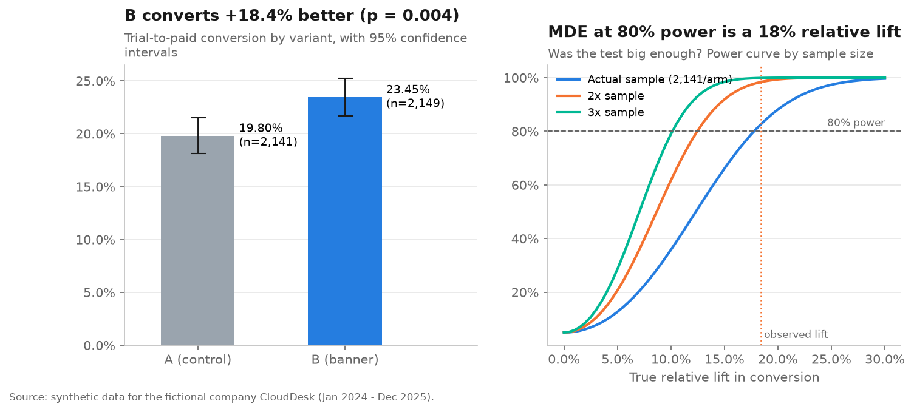

# Pricing-page A/B test readout

> Fictional company, synthetic data. Generated by `analysis/ab_test.py`; every number below is computed on this run.

## Recommendation: **SHIP**

Conversion lift is statistically significant, the whole CI is positive and no guardrail is harmed.

## Design
- **Hypothesis:** an annual-discount banner on the pricing page (B) increases trial-to-paid conversion vs the current page (A).
- **Randomisation unit:** account, 50/50 at signup. **Window:** 2025-07-01 to 2025-09-30 signups (all have completed the 14-day trial).
- **Primary metric:** trial-to-paid conversion. **Guardrails:** starting MRR, plan mix, activation, 60-day churn of converters.
- **Alpha** 0.05, two-sided. **Target power** 80%.

## Sample and SRM
| | A (control) | B (treatment) |
|---|---:|---:|
| Accounts | 2,141 | 2,149 |
| Converted | 424 | 504 |

SRM chi-square p = 0.903 -> no sample-ratio mismatch.

## Primary metric
| Metric | Value |
|---|---|
| Conversion A / B | 19.80% / 23.45% |
| Absolute lift (B - A) | +3.65% (95% CI +1.18% to +6.11%) |
| Relative lift | +18.4% (bootstrap 95% CI +5.5% to +32.6%) |
| z / p-value | 2.90 / 0.0037 |
| Bayesian P(B > A) | 99.8% |

## Guardrails
| Guardrail | A | B | p-value | Status |
|---|---|---|---:|---|
| Avg starting MRR of converters | 75.6 | 77.8 | 0.577 | OK - no significant difference |
| Plan mix of converters (Starter/Pro/Business) | [0.469, 0.363, 0.167] | [0.456, 0.363, 0.181] | 0.856 | OK - no significant difference |
| Activation rate (invited teammate) | 24.61% | 25.92% | 0.326 | OK - no significant difference |
| 60-day churn of converters | 6.84% | 3.37% | 0.015 | OK - B better, but not significant after Bonferroni (p >= 0.0125); treat as noise |

## Power and minimum detectable effect
- Sample per arm: **2,141**. Achieved power for the observed effect: **83%**.
- MDE at 80% power with this sample: **+3.52% absolute (+18% relative)**.
- Sample per arm needed to detect the observed lift at 80% power: **1,996**
  (already reached by this test).
- Sample per arm needed for a 10% relative lift: 6,589.

## Business impact (if the point estimate is real)
At ~1,430 signups/month and $78 average starting MRR, B would add about
**$4,062 of new MRR per month** (95% CI $1,319 to $6,799), i.e. ~$48,746 ARR per month of signups.

## Assumptions and caveats
- Accounts are independent; no cross-variant contamination (one account sees one variant).
- The z-test relies on the normal approximation (np > 10 in both arms - satisfied).
- One primary metric is pre-registered, so no multiple-comparison correction is applied to it. Guardrails are read as
  "do no harm" at alpha = 0.05 (conservative), and any *improvement* is only credited if it survives Bonferroni (p < 0.0125).
- A conversion lift does not guarantee an LTV lift: annual-discount buyers may retain differently. Monitor 6-month retention after launch.
- No peeking: the readout is computed once on the full, pre-defined window.
- **Winner's curse:** the observed lift (+18.4%) is close to the MDE (+18%), so a significant
  result at this sample size tends to *overstate* the true effect. Forecast impact from the lower part of the CI, not the point estimate.

