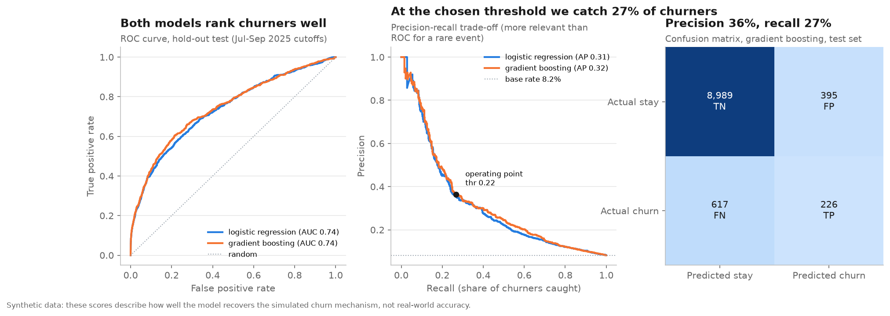
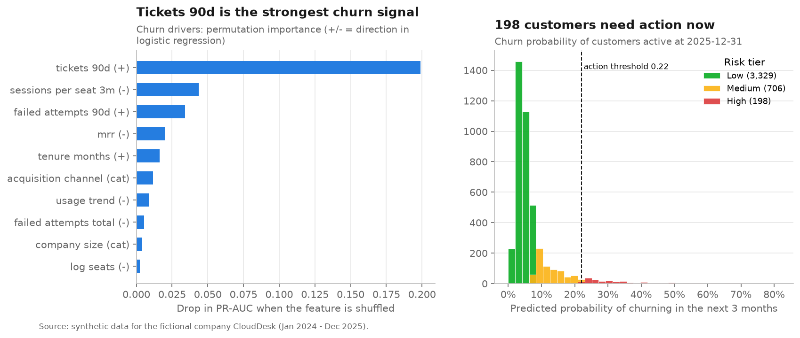
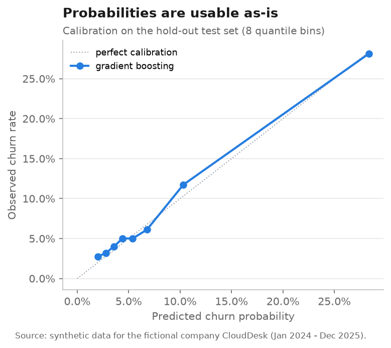

# Churn prediction model

> Fictional company, synthetic data. Generated by `analysis/churn_model.py`. Model performance describes how well the
> model recovers the *simulated* churn mechanism; it is **not** an estimate of real-world predictive performance.

## Problem definition
- **Target:** a customer paying at a month-end cutoff churns within the next 3 months (`churned_next_3m`).
- **Population:** every customer with MRR > 0 at the cutoff; one row per customer per monthly cutoff.
- **Why 3 months:** long enough for Customer Success to act, short enough for the signal to be fresh.

## Leakage prevention and validation
| split | cutoffs | rows | customers | churn rate |
|---|---|---:|---:|---:|
| train | 2024-06-30 .. 2025-03-31 | 16,081 | 2,796 | 7.9% |
| validation | 2025-04-30 .. 2025-06-30 | 8,372 | 3,127 | 8.1% |
| test | 2025-07-31 .. 2025-09-30 | 10,227 | 3,802 | 8.2% |

- Features use only events stamped on or before the cutoff and **complete** usage months (the in-progress month is excluded).
- Splits are **out-of-time**; the test set is scored once, after model and threshold were fixed on validation.
- The same customer can appear in several snapshots (different cutoffs); because splits are by time, no future
  information reaches training.

## Features (14 numeric + 4 categorical)
Plan and MRR at the cutoff, tenure, activation flag, sessions per seat (last 3 complete months), usage trend
(last 3 vs prior 3 months), seats, missing usage months, failed payment attempts (90 days and total), support tickets
(90 days and total), upgrades, downgrades, company size, acquisition channel and country.

## Model comparison (hold-out test)
| model | accuracy | precision | recall | F1 | ROC-AUC | PR-AUC | Brier | threshold | net value |
|---|---:|---:|---:|---:|---:|---:|---:|---:|---:|
| baseline_majority | 0.918 | 0.000 | 0.000 | 0.000 | 0.500 | 0.082 | 0.076 | 0.08 | $0 |
| logistic_regression | 0.918 | 0.500 | 0.178 | 0.262 | 0.735 | 0.313 | 0.067 | 0.32 | $8,088 |
| gradient_boosting | 0.901 | 0.364 | 0.268 | 0.309 | 0.744 | 0.322 | 0.066 | 0.22 | $6,538 |

Selected: **gradient boosting** (highest validation PR-AUC). Note: on the hold-out test, **logistic regression** produced more net value ($8,088 vs $6,538) at its own threshold. The choice was fixed on validation before looking at test, so it is reported rather than switched - the two models are close, and the simpler logistic regression is a defensible alternative where explainability matters most. Accuracy is shown for completeness, but with a
8.2% base rate a model that predicts "nobody churns" is already 91.8% accurate, so it is not used for selection.

## Choosing the threshold: false positives vs false negatives
- **False positive** (we contact a customer who would have stayed): costs ~$40 of CSM time / incentive.
- **False negative** (we miss a churner): loses the chance to save them, worth
  25% x 80% margin x 12 months x their MRR (≈ $197 for an average customer).
- Because a miss costs far more than a wasted call, the value-maximising threshold is low (**0.22**), which trades
  precision for recall. On the test set it flags 6% of customers, catches
  27% of churners at 36% precision, and creates an estimated
  **$6,538** of net value over three monthly cohorts. If CSM capacity is the constraint, raise the threshold.

## Churn drivers (permutation importance on the test set)
| feature | PR-AUC drop | direction |
|---|---:|---|
| tickets_90d | 0.1991 | higher -> more churn |
| sessions_per_seat_3m | 0.0438 | higher -> less churn |
| failed_attempts_90d | 0.0341 | higher -> more churn |
| mrr | 0.0198 | higher -> less churn |
| tenure_months | 0.0163 | higher -> more churn |
| acquisition_channel | 0.0115 | categorical |
| usage_trend | 0.0091 | higher -> less churn |
| failed_attempts_total | 0.0054 | higher -> less churn |
| company_size | 0.0040 | categorical |
| log_seats | 0.0025 | higher -> less churn |

## Risk tiers for customers active at 2025-12-31
Tiers: **High** = probability >= action threshold (0.22); **Medium** = above the historical base rate (8.1%);
**Low** = below the base rate.

| tier | customers | MRR | avg probability | expected MRR loss (3m) | recommended action |
|---|---:|---:|---:|---:|---|
| High | 198 | $13,572 | 34.2% | $4,565 | CSM call within 7 days; payment-method update if payment failed; offer annual plan / training session |
| Medium | 706 | $46,614 | 12.7% | $5,986 | Automated re-engagement: feature tips, in-app nudges, check-in email from CSM |
| Low | 3,329 | $287,821 | 4.4% | $11,292 | Business as usual; target with expansion offers |

Each customer in `data/marts/churn_scores.parquet` also carries `risk_reasons` (rule-based reason codes such as
"usage down 30%+" or "recent failed payment") so Customer Success knows *why* they were flagged.

## Recommendations for reducing churn
1. **Fix involuntary churn first** - failed payments are a top driver and the cheapest to fix: card-updater service,
   pre-expiry reminders, smarter retry timing and a grace period before cancellation.
2. **Engagement early-warning:** trigger CSM outreach when sessions per seat fall 30%+ versus the prior quarter.
3. **Drive activation:** customers who never invited a teammate churn more - push teammate invites in onboarding.
4. **First-90-days programme** for new customers (onboarding call, success plan), where hazard is highest.
5. **Measure the intervention:** hold out a random 10-20% of High-risk customers from outreach to estimate the true save rate.

## Limitations
- Synthetic data: the churn mechanism was generated by `scripts/generate_data.py`, so the model can recover it unusually well.
- Snapshots of the same customer are correlated; metrics are point estimates without confidence intervals.
- Economic assumptions (save rate, outreach cost) are illustrative and should be replaced with measured values.

