# Exploratory data analysis - findings

> CloudDesk is a **fictional** company and all data is **synthetic**. Numbers below are computed by `analysis/eda.py` on the current pipeline run; they are not real-world benchmarks.

## Data quality
- 4 raw columns have genuine gaps or duplicates; the worst is `accounts.country` with 260 rows (1.0%). Structural NULLs (e.g. `end_date` of active subscriptions) are expected and excluded.

## Outliers
- IQR fences for sessions/seat are 2.7-24.4; 1,368 account-months (3.1%) fall outside, 1,358 of them on the low side; |z|>3 flags 224. 55% of accounts behind low-usage outlier months later churned, so outliers are kept as signal rather than removed.

## Univariate
- 49% of signups are 1-10-employee companies. Median tenure of churned customers is 5 months; 30% of churners leave within their first 2 months.

## Acquisition
- Signups: 10,670 in 2024 vs 16,511 in 2025 (+54.7%). Organic is the largest source (30% of signups), then paid search (25%).

## Revenue
- MRR $149K (Dec-2024) -> $348K (Dec-2025); ARR $4.2M. Month-over-month growth fell from 10.2% (Jan-2025) to 5.1% (Dec-2025). Over the last 6 months churned + contraction MRR equalled 43% of new MRR.

## Retention
- Weighted Month-12 logo retention is 71.9%. Best channel: Referral (78.5%); worst: Paid social (65.6%).

## Channels
- LTV/CAC: Content 8.8x (CAC $238), Paid social 4.5x (CAC $394), Paid search 4.2x (CAC $487), Partner 3.5x (CAC $776).

## Bivariate
- Signup-to-paid is 45.3% for activated trials vs 12.5% for non-activated. Among customers paying since mid-2025 or earlier, 26.8% of activated vs 36.1% of non-activated have churned (chi-square p = 2.3e-09).
- 3-month churn is 13.7% in the lowest engagement decile vs 5.2% in the highest (Mann-Whitney U p = 1.3e-09).

## Multivariate
- Monthly churn ranges from 1.4% (Business, 51-200 employees) to 3.8% (Starter, 1-10 employees). Spearman correlation of churn with sessions/seat is -0.35, with failed payments +0.14, with support tickets +0.07.

## Segmentation
- The top 20% of active customers generate 57% of collected revenue. Churn reasons: payment failure 28%, too expensive 20%, missing features 16%, switched competitor 15%, low usage 14%, business closed 6%.

## Charts

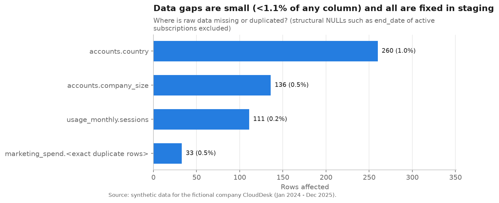
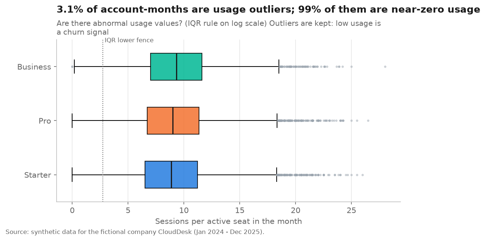
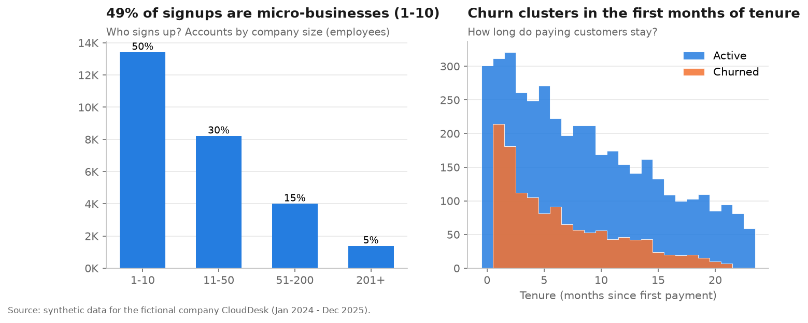
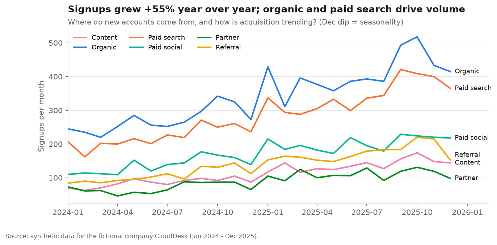
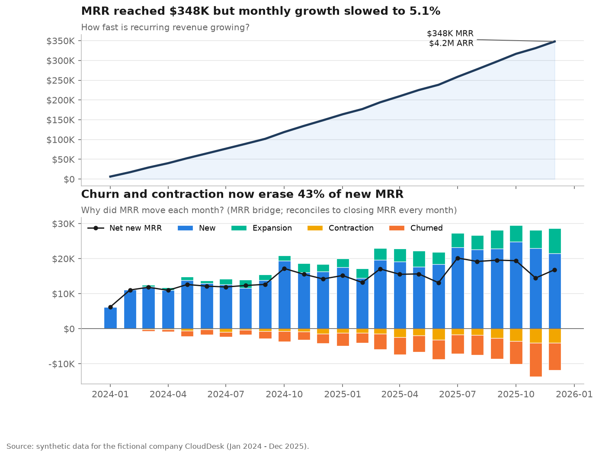
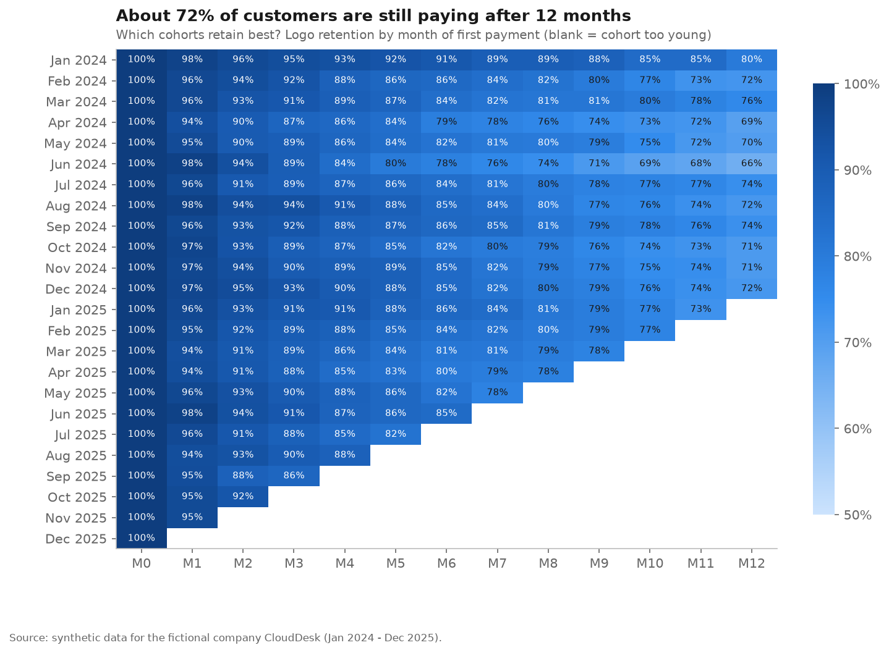
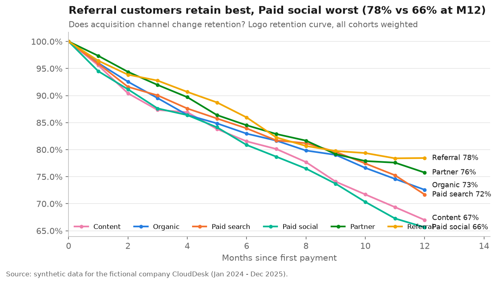
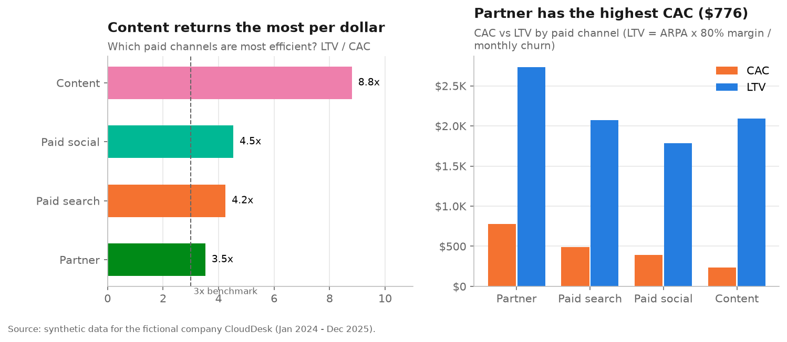
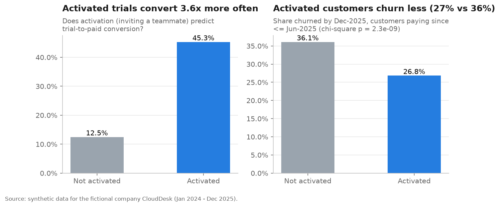
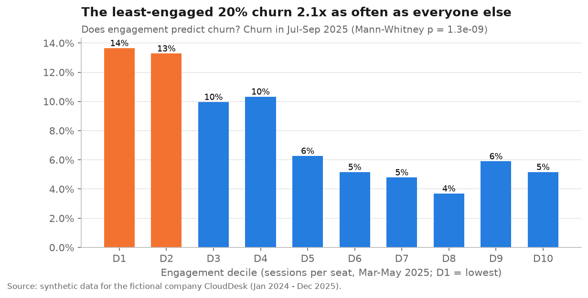
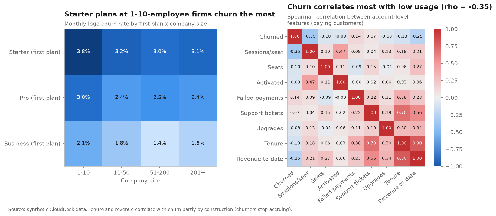
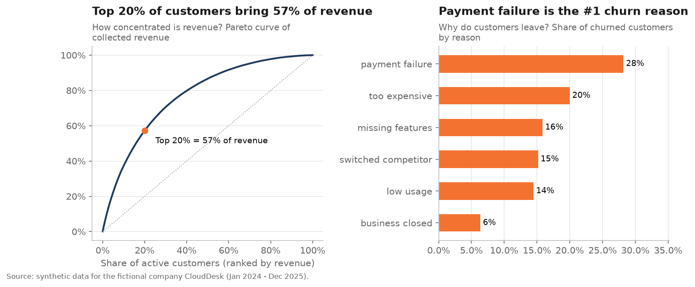
