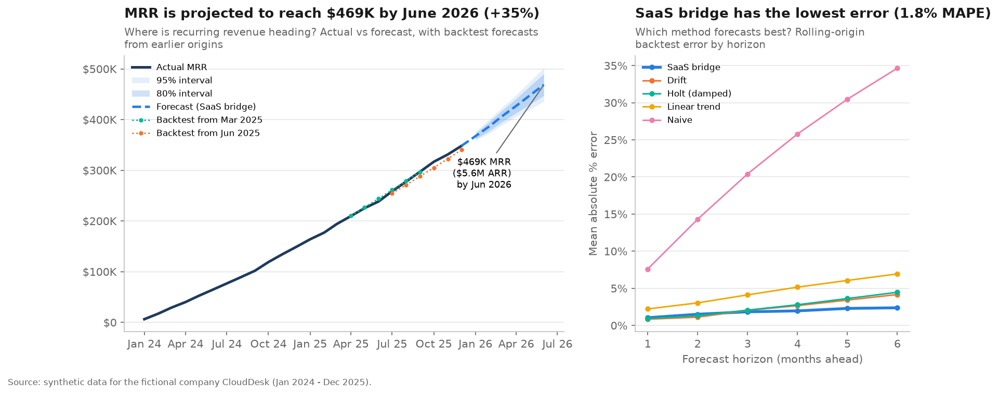

# MRR forecast (next 6 months)

> Fictional company, synthetic data. Generated by `analysis/forecast_mrr.py`.

## Result
Selected model: **saas bridge** (lowest rolling-origin backtest MAPE). MRR is projected to grow from
**$348,007** (Dec 2025) to **$468,585** in June 2026 (+34.6%),
an ARR run-rate of **$5,623,020**. For reference, the other methods end at: naive $348K, drift $458K, linear trend $450K, holt damped $447K.

| Month | Forecast MRR | 80% interval | 95% interval | ARR run-rate |
|---|---:|---:|---:|---:|
| Jan 2026 | $367,200 | $361,571 - $372,830 | $358,591 - $375,810 | $4,406,402 |
| Feb 2026 | $386,763 | $377,738 - $395,787 | $372,961 - $400,565 | $4,641,151 |
| Mar 2026 | $406,688 | $395,310 - $418,067 | $389,287 - $424,090 | $4,880,257 |
| Apr 2026 | $426,971 | $412,893 - $441,049 | $405,440 - $448,501 | $5,123,650 |
| May 2026 | $447,605 | $429,705 - $465,505 | $420,230 - $474,980 | $5,371,261 |
| Jun 2026 | $468,585 | $447,124 - $490,046 | $435,764 - $501,406 | $5,623,020 |

## Backtest (rolling origin Dec 2024 - Jun 2025, horizons 1-6)
| model | MAE | RMSE | MAPE | bias |
|---|---:|---:|---:|---:|
| saas_bridge | 4,542 | 6,005 | 1.84% | +0.61% |
| drift | 6,637 | 8,725 | 2.37% | -2.23% |
| holt_damped | 7,127 | 9,816 | 2.53% | -2.34% |
| linear_trend | 11,888 | 13,293 | 4.59% | -4.59% |
| naive | 58,192 | 65,421 | 22.21% | -22.21% |

Positive bias = the model over-forecast on average.

## Assumptions
- **SaaS bridge model:** the existing customer base keeps its recent (6-month average) monthly net retention, and new
  MRR keeps following its 12-month linear trend. No price changes, launches or large marketing shifts.
- The pricing-page change recommended by the A/B test is **not** included; it would add upside to new MRR.
- Prediction intervals come from the chosen model's own backtest errors by horizon.

## Limitations
- Only 24 months of history, the first months being the company's ramp-up; seasonality cannot be estimated reliably.
- Seven backtest origins make the error estimates and intervals indicative only.
- Point forecasts are conditional on the business continuing as observed; churn shocks or macro changes are not modelled.

